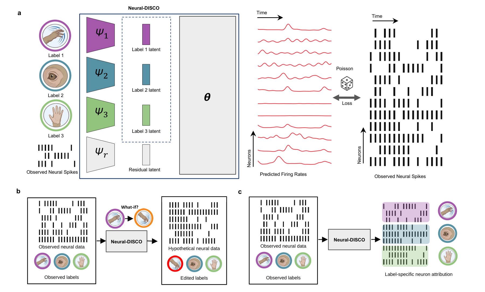
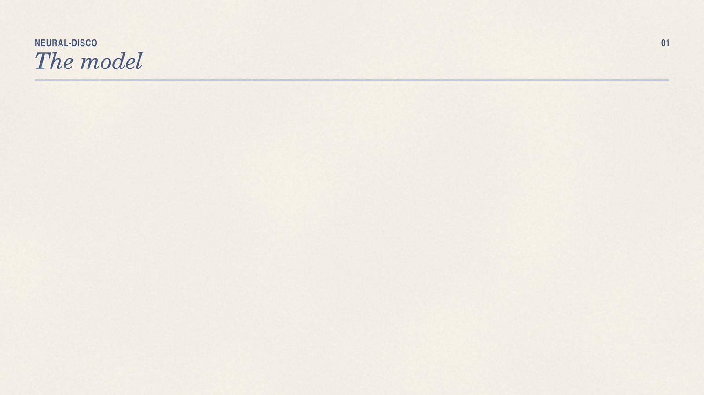

# Neural-DISCO

Code for the NeurIPS 2026 paper **Neural-DISCO: Source-Conditioned Counterfactual Editing of Neural Population Activity**.



<p align="center"></p>

## Installation

```bash
git clone https://github.com/TangLab-UBC/Neural-DISCO-neurips.git && cd Neural-DISCO-neurips
conda env create -f environment.yaml
conda activate neural-disco
pip install -r requirements-pivae.txt -r requirements-neds.txt
pip install nlb_tools==0.0.3  # MC Maze
git clone https://github.com/zhd96/pi-vae.git && git -C pi-vae checkout cc77ac7068dabede095108000b07cf57abbd0f96
git clone https://github.com/yzhang511/NEDS.git && git -C NEDS checkout 61d2ef65556dbbc2b828d542f19bd4e7134c92f3
```

All commands run from the repository root, where `pi-vae/` and `NEDS/` are cloned. NEDS needs a CUDA GPU.

Allen Visual Coding needs AllenSDK, which pins older packages, so use a separate environment:

```bash
conda env create -n neural-disco-allen -f environment.yaml
conda activate neural-disco-allen
pip install -r requirements-pivae.txt -r requirements-neds.txt allensdk==2.15.2
```

## Data

- RatInABox: `python scripts/rat_in_a_box_generate_datasets.py configs/rat_in_a_box_custom/mlp_counterfactual_spikes_iw1_cv.yaml`
- MC Maze: `pip install dandi && mkdir -p datasets/nlb_datasets && dandi download DANDI:000128/0.220113.0400 -o datasets/nlb_datasets`
- Allen Visual Coding: downloaded automatically into `datasets/allen_vc/`. The configs run session 756029989; to run the other paper sessions, set `session_id` and `num_neurons` from `configs/allen_vc/sessions.txt`.

## Training and evaluation

Train the models, then evaluate the counterfactual edits:

```bash
# RatInABox (Fig. 2d–e)
python scripts/train.py configs/rat_in_a_box_custom/mlp_counterfactual_spikes_iw1_cv.yaml
python scripts/train.py configs/rat_in_a_box_custom/mlp_counterfactual_spikes_iw1_no_unknown_reg_cv.yaml
python scripts/cfact/rat_mlp_behaviour_only_baseline.py configs/rat_in_a_box_custom/mlp_counterfactual_spikes_iw1_cv.yaml \
  --ablation-config configs/rat_in_a_box_custom/mlp_counterfactual_spikes_iw1_no_unknown_reg_cv.yaml
# head-direction reversal (Fig. 2f–g)
python scripts/cfact/rat_mlp_behaviour_only_baseline.py configs/rat_in_a_box_custom/mlp_counterfactual_spikes_iw1_cv.yaml \
  --ablation-config configs/rat_in_a_box_custom/mlp_counterfactual_spikes_iw1_no_unknown_reg_cv.yaml \
  --counterfactual-mode inverse_trajectory

# MC Maze (Fig. 3b, 3e)
python scripts/train.py configs/mc_maze/mlp_kinematics_eye_pos_iw1_tuned_cv10.yaml
python scripts/train.py configs/mc_maze/mlp_kinematics_eye_pos_iw1_tuned_noreg_cv10.yaml
python scripts/cfact/mc_maze_mlp_transform_model_cv.py --config configs/mc_maze/mlp_kinematics_eye_pos_iw1_tuned_noreg_cv10.yaml
python scripts/cfact/pivae_behaviour_only_baseline.py configs/mc_maze/mlp_kinematics_eye_pos_iw1_tuned_cv10.yaml
python scripts/cfact/neds_behaviour_only_baseline.py configs/mc_maze/mlp_kinematics_eye_pos_iw1_tuned_cv10.yaml
python scripts/cfact/mc_maze_mlp_transform_model_cv.py --config configs/mc_maze/mlp_kinematics_eye_pos_iw1_tuned_cv10.yaml \
  --pivae-metrics logs/mc_maze-mlp_kinematics_eye_pos_iw1_tuned_cv10/results/pivae_behaviour_only_baseline_cv_metrics.json \
  --neds-metrics logs/mc_maze-mlp_kinematics_eye_pos_iw1_tuned_cv10/results/neds_baseline_cv_metrics.json \
  --ablation-metrics logs/mc_maze-mlp_kinematics_eye_pos_iw1_tuned_noreg_cv10/results/counterfactual_transform_model_cv_metrics.json

# Allen Visual Coding (Fig. 4c, 4e; in neural-disco-allen)
python scripts/train.py configs/allen_vc/decode_stim_speed_orientation_cv10.yaml
python scripts/train.py configs/allen_vc/decode_stim_speed_orientation_noreg_cv10.yaml
python scripts/train.py configs/allen_vc/gaussian-glm-cv10.yaml
python scripts/cfact/allen_speed_mean_baselines.py configs/allen_vc/decode_stim_speed_orientation_cv10.yaml \
  --baselines neural_disco no_reg gaussian_glm pivae neds
```

Checkpoints, results and figures are written under `logs/`. In the configs, `l2_unknown` and `unknown_sigma` are λ and σ, `latent_dim` and `unknown_attribute_latent_dim` are the label and residual latent sizes, and `behaviour_num_layers`/`unknown_num_layers`/`decoder_num_layers` are the factor/residual/generator depths. Zero-residual and GLM baselines other than the Allen Gaussian GLM are not included.

## Attribution

```bash
# RatInABox (Fig. 2b)
for cfg in configs/rat_in_a_box_custom/l2_attr_cv/*.yaml; do
  python scripts/train.py $cfg
  python scripts/attribution/attribute.py $cfg
  python scripts/AUC.py $cfg
done
python scripts/ablations/plot_l2_auc.py --config-dir configs/rat_in_a_box_custom/l2_attr_cv
```

The same loop works for `configs/mc_maze/l2_attr_cv` (Fig. 3d) and `configs/allen_vc/l2_ablation_attr_cv` (Fig. 4f; Allen in `neural-disco-allen`). For Allen, also run:

```bash
# Allen (Fig. 4l)
python scripts/ablations/plot_corr_l2_allen.py --config-dir configs/allen_vc/l2_ablation_attr_cv
```

## Citation

```bibtex
@inproceedings{policzer2026neuraldisco,
  title     = {Neural-{DISCO}: Source-Conditioned Counterfactual Editing of Neural Population Activity},
  author    = {Policzer, Nico and Ho, James and Soo, Joseph and Tang, Xin},
  booktitle = {Advances in Neural Information Processing Systems},
  year      = {2026}
}
```

## License

MIT. See [LICENSE](LICENSE).
